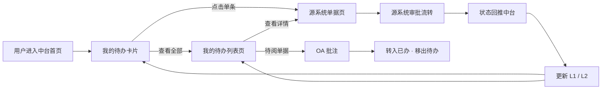
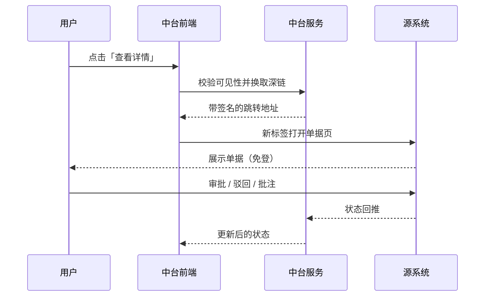
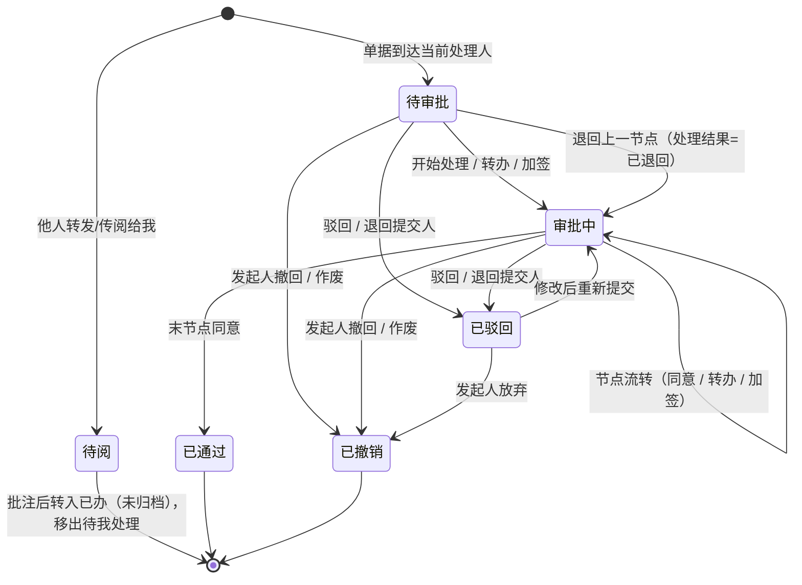
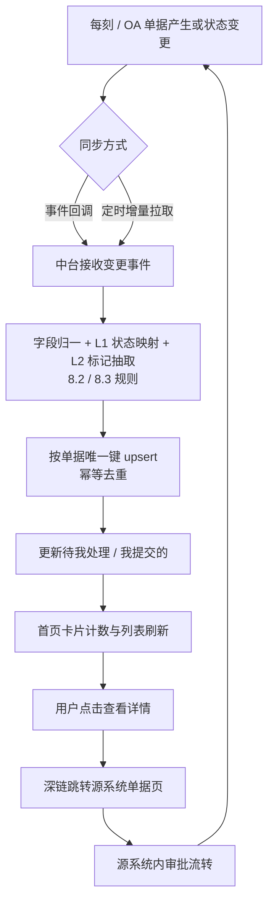
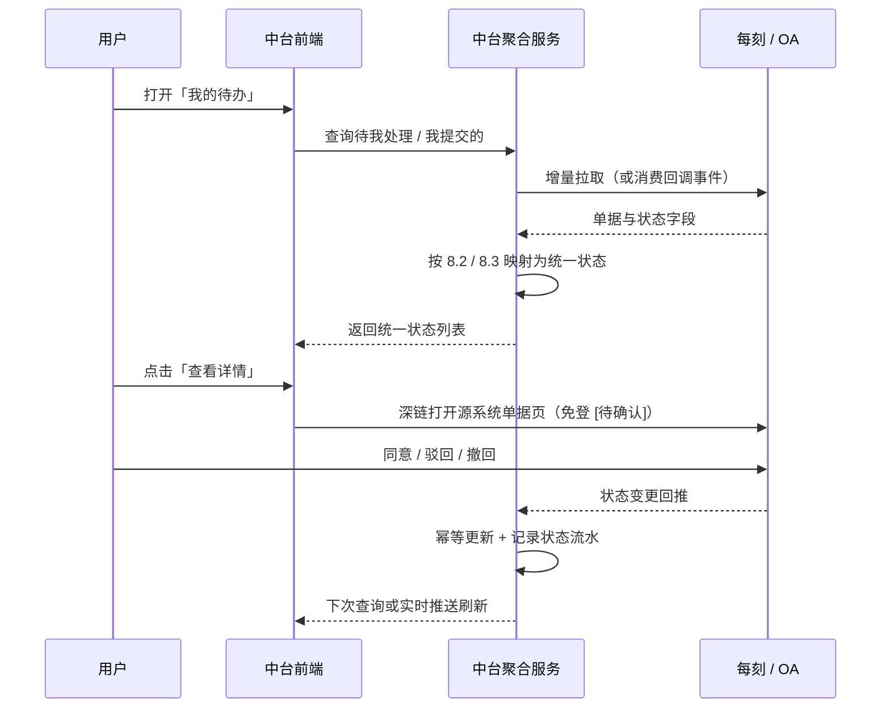

# 柏星龙业务数字化中台 - 我的待办 PRD

| 字段 | 内容 |
| --- | --- |
| 产品类型 | B端数字化中台 / 审批待办聚合 + 流程引擎 |
| 版本 | v0.3 |
| 日期 | 2026-11-27 |
| 状态 | 草稿 |

## 修改记录

| 日期 | 版本 | 变更 | 修改人 |
| --- | --- | --- | --- |
| 2026-11-25 | v0.1 | 初始化 PRD | [待确认] |
| 2026-11-25 | v0.1 | 批次 1：文档头、项目背景、目标与范围 | [待确认] |
| 2026-11-25 | v0.2 | 补充用户场景、信息架构、功能总览、三个核心模块、业务规则、权限数据埋点、验收与风险 | [待确认] |
| 2026-11-27 | v0.3 | 新增第 12 章「流程中心：中台 BPM 引擎」；修订 1.5 范围、3.3 职责边界，明确「中台建 BPM 但只承载新增与自建流程，存量继续原系统运行并分批迁移归档」 | [待确认] |

---

## 1. 项目背景

### 1.1 背景

柏星龙的审批业务分布在多个系统：费用报销、付款类单据在每刻（Maycur）流转，合同、采购、人事等单据在泛微 OA 流转。员工处理待办需要分别登录各业务系统逐一查找；发起人查看自己提交单据的进度，也要在各系统间来回切换。各系统状态口径不一致（如 OA 的「已归档」对应每刻的「已通过」），难以形成统一视图与统计。

中台已完成各业务系统入口的集成，本期在首页概览落地「我的待办」：聚合每刻与泛微 OA 的审批单据，提供【待我处理】【我提交的】两个视角。**存量单据**的审批动作仍在源系统内完成，中台只做聚合展示、状态归一与跳转；**新增与中台自建流程**由中台 BPM 引擎承载，在中台内完成建模、发起与办理（见第 12 章）。

### 1.2 现状与问题

| 编号 | 问题 | 现状 | 影响 |
| --- | --- | --- | --- |
| P1 | 待办分散 | 每刻、OA 各自维护待办列表 | 员工多系统登录切换，容易漏办、超时 |
| P2 | 状态口径不一致 | 各系统状态命名与粒度不同（如「已归档」「审批完成」「未归档」） | 无法统一筛选、统计与预警 |
| P3 | 提交进度不可见 | 「我提交的」需逐个系统查询 | 发起人无法快速判断单据卡在哪个节点 |
| P4 | 重复建设风险 | 若中台自建审批页，需与源系统双向写入 | 状态不一致、维护成本高 |

### 1.3 产品目标

| 类型 | 目标 |
| --- | --- |
| 业务目标 | 员工处理审批不再切换系统；发起人可统一追踪单据进度 |
| 产品目标 | 聚合每刻/OA 的待办与我提交单据，统一状态与筛选，点击详情跳转源系统完成处理 |
| 技术目标 | 建立「源系统字段 → 中台统一状态」映射与状态回推机制，保证中台与源系统最终一致 |

### 1.4 成功指标

| 指标 | 定义 | 统计口径 | 目标值 |
| --- | --- | --- | --- |
| 待办聚合覆盖率 | 中台可见待办数 / 源系统实际待办数 | 每自然日抽样比对 | [待确认: 建议 ≥99%] |
| 状态一致率 | 抽样单据中台状态与源系统一致的比例 | 每日抽样 100 单 | [待确认: 建议 ≥99.5%] |
| 待办处理渗透率 | 从「我的待办」点击查看详情的单据数 / 中台展示待办数 | 按周统计 | [待确认] |
| 单据平均处理时长 | 单据到达至处理完成的时间 | 按源系统、单据类型分维度 | [待确认] |
| 列表页性能 | 首屏可交互耗时（P95） | 前端性能采集 | [待确认: 建议 ≤2s] |

### 1.5 范围

**本期范围内**

| 范围 | 内容 |
| --- | --- |
| 数据聚合 | 每刻、泛微 OA 的「待我处理」与「我提交的」单据 |
| 首页卡片 | 我的待办卡片、双 Tab 计数、每 Tab 3 条预览、「查看全部」入口 |
| 列表页 | 双 Tab、筛选（标题/类型/状态/优先级/来源系统）、优先级图例、8 列表格、空状态 |
| 查看详情 | 跳转源系统单据页（新标签页打开，原型以 biz-detail.html 模拟） |
| 状态回推 | 源系统状态变更后同步中台（同步机制 [待确认]） |
| 流程中心（中台 BPM） | 流程分类、轻量化建模、表单设计与 URL 表单、定义发布与版本、实例与任务、迁移与归档；仅承载**新增与中台自建流程**（详见第 12 章） |

**本期不做**

| 不做项 | 原因 |
| --- | --- |
| 存量流程的在线审批页 | 泛微 OA / 每刻的存量单据仍在源系统办理，中台只聚合待办与跳转；双写会与源系统状态冲突 |
| 存量流程强制迁移 | 新流程只在中台建，存量按分类分批迁入，未迁入期间继续在原系统运行 |
| 全量替换 OA | 本期目标是「新流程有引擎可用」，不做 OA 一次性下线；替换节奏由迁移批次决定 |
| T100、CRM、SRM 等其他系统待办接入 | 本期仅每刻与泛微 OA，后续按同一模型扩展 |

### 1.6 术语表

| 术语 | 定义 |
| --- | --- |
| 中台 | 柏星龙业务数字化中台 |
| 源系统 | 产生并流转审批单据的业务系统，本期为每刻、泛微 OA |
| 待我处理 | 当前用户作为审批人/处理人、需要处理的单据 |
| 我提交的 | 当前用户作为发起人提交的单据 |
| 统一状态 | 中台归一的展示状态，分三层：任务状态（待我审批 / 待阅）、单据进度（审批中 / 已通过 / 已驳回 / 已撤销）、处理结果（已同意 / 已驳回 / 已退回 / 已阅 / 已转办） |
| 查看详情 | 中台跳转到源系统单据页的动作 |
| 回推 | 源系统状态变更后同步给中台的机制 |
| 中台 BPM | 中台自建的流程引擎，承载新增与自建流程的建模、表单、流转与任务 |
| 流程模型 / 流程定义 | 模型是设计稿；发布后成为带版本的定义，实例按定义运行 |
| 流程实例 | 一次流程发起产生的运行实体（如一张合同评审单） |
| 任务 | 实例在某个环节产生的待办项，分配给具体处理人 |
| 归档 | 已结束实例转只读留存，不可办理，仅可查询与审计 |

---

## 2. 用户、角色与场景

### 2.1 角色定义

| 角色 | 定义 | 核心诉求 | 当前痛点 |
| --- | --- | --- | --- |
| 审批人（处理人） | 单据流转到其节点、需要处理的用户 | 一屏看清「等我处理」的单据并快速进入处理 | 多系统登录、容易漏办与超时 |
| 发起人 | 提交单据的员工 | 统一查看自己单据的进度、当前卡在谁那里 | 需逐系统查询、进度不透明 |
| 待阅人 | 收到他人转发/传阅审批的用户 | 区分「要我做决策」与「只是让我阅知」 | 待阅与真实待办混在一起，易误操作 |
| 中台管理员 | 负责数据核对与字典维护 | 状态一致、异常可追溯 | 缺状态流水、各系统口径不统一 |

### 2.2 核心场景

| 编号 | 场景 | 角色 | 触发 | 期望结果 |
| --- | --- | --- | --- | --- |
| U1 | 日常处理待办 | 审批人 | 上班打开中台首页 | 看到待办数量与最近 3 条，一点进入列表处理 |
| U2 | 追踪我提交的单据 | 发起人 | 想知道审批进度 | 看到统一状态与当前审批人 |
| U3 | 待阅并批注 | 待阅人 | 同事转发审批给我 | 列表出现「待阅」，跳转 OA 批注后自动消失 |
| U4 | 超时提醒 | 审批人 | 单据接近或超过截止时间 | 看到超时标记，可优先处理 |
| U5 | 异常核对 | 管理员 | 中台与源系统状态不一致 | 依据状态流水定位问题单据 |

### 2.3 JTBD

- 当我要审批单据时，我想在一个地方看到所有系统的待办，这样我不会漏办、不会超时。
- 当我提交单据后，我想知道它卡在哪个节点、当前谁在处理，这样我能主动跟进。
- 当别人转发单据给我时，我想一眼区分「要我做决策」和「只是让我看」，这样我不会误操作。

---

## 3. 信息架构与业务闭环主流程

### 3.1 信息架构

```
中台
├─ 首页概览
│   └─ 我的待办卡片（Tab：待我处理 / 我提交的 · 计数 · 3 条预览 · 查看全部）
├─ 我的待办列表页
│   ├─ 顶部统计卡片（待我处理 / 超时 / 我提交进行中 / 我提交已完成）
│   ├─ 待我处理（9 列：单据、来源、类型、当前环节、提交人、金额、提交时间、状态、操作）
│   ├─ 我提交的（当前处理人 / 最后更新）
│   └─ 筛选：名称 / 编号 / 人员、来源系统、状态、单据类型
└─ 查看详情
    └─ 源系统单据页（每刻报销 / 泛微 OA）
```

### 3.2 主流程



### 3.3 触点与职责边界

| 触点 | 中台职责 | 不做什么 |
| --- | --- | --- |
| 首页卡片 | 计数、3 条预览、入口 | 不提供审批按钮 |
| 列表页 | 聚合、筛选、状态归一、跳转 | 不承载审批动作 |
| 源系统 | 审批、流转、批注、产生数据 | 不反向控制中台展示 |
| 中台服务 | 存量流程：聚合、映射、回推、对账、状态流水；中台 BPM：建模、表单、引擎流转、事件回写 | 存量流程不生成单据、不承载审批；中台 BPM 只承载新增与自建流程 |

---

## 4. 功能需求总览

| 编号 | 功能 | 说明 | 优先级 | 验收要点 |
| --- | --- | --- | --- | --- |
| F1 | 首页我的待办卡片 | 双 Tab 计数、3 条预览、查看全部 | P0 | 计数与列表条数一致 |
| F2 | 待我处理列表 | 顶部 4 张统计卡片；聚合每刻/OA 待办，9 列展示 | P0 | 统计口径与列表一致、超时文字提示 |
| F3 | 我提交的列表 | 人员列显示当前审批人 | P0 | 终态显示 — |
| F4 | 筛选与搜索 | 标题、原系统分类、6 个 L1 状态、来源系统 | P0 | 多条件叠加生效 |
| F5 | 查看详情跳转 | 新标签打开源系统单据页 | P0 | 跳转成功率 [待确认] |
| F6 | 状态同步 | 事件回推 + 快照兜底 | P0 | 状态一致率达标 |
| F7 | 待阅 | 待阅状态展示与批注后移除 | P0 | 批注后不再出现在待我处理 |
| F8 | 空态与异常 | 空列表、接口失败、单据失效提示 | P1 | 提示可理解、可重试 |
| F9 | 权限隔离 | 仅本人相关单据可见 | P0 | 越权访问被拦截 |
| F10 | L2 待办标记 | 保留在数据层；列表不单独成列，超时由「已等待」列表达 | P1 | 不改变 L1；未读/代办等按需再加标签 |

---

## 5. 核心模块：待我处理

### 5.0 Tab 结构、统计卡片与决策

Tab 按「我与单据的关系」划分，不按系统划分：

| Tab | 定义 | 子筛选 |
| --- | --- | --- |
| 待办事项 | 需要我动作的单据 | 全部 / 待我审批 / 待阅 / 被退回 / 被督办 |
| 我发起的 | 我是提交人 | 全部 / 进行中 / 已完成 / 已驳回 / 已撤销 |
| 已办事项 | 我处理过的单据 | 全部 / 已同意 / 已驳回 / 已退回 / 已转办 / 已阅 |

v0.3 已定决策：

| 编号 | 决策 | 说明 |
| --- | --- | --- |
| C1 | 已办事项纳入本期 | OA + 每刻，近 90 天；超过 90 天引导去源系统查询 |
| C2 | 状态展示 | 统一 L1 为主，悬浮显示源系统原文（如「已归档」「已结束」） |
| C3 | 撤回后重新提交 | 按业务单号关联为一条，展示最新版本；历史版本在详情可查 |
| C4 | 列表字段 | 一套骨架 + 三个 Tab 局部替换：待办=提交人/接收时间；我发起=当前处理人/最后更新；已办=发起人/处理时间/处理结果+单据状态 |
| C5 | 不设顶部统计卡片 | 数量直接展示在 Tab 上，顶部仅保留 Tab 与筛选区，减少纵向占用 |
| C6 | 已办含在途单据 | 已办 = 我处理过的全部（含仍在流转的）；「处理结果」表达我的动作，「单据状态」表达单据是否终态 |

页面不设顶部统计卡片：各 Tab 直接显示数量，顶部只保留 Tab 与筛选区。

### 5.1 字段规格

| 列 | 数据来源 | 展示规则 | 示例 |
| --- | --- | --- | --- |
| 单据 | 单据名称 + 单据编号 | 两行展示；标题过长单行省略、悬浮显示全称；未读时标题前有蓝色圆点；超时在标题后以红色文字「已超时」展示；编号灰色小字 | ● 供应商准入资质审批 已超时 / OA-2026-11-0801 |
| 来源系统 | 单据所属系统 | 纯文字展示，不加图标/徽标：每刻、泛微 OA | 泛微 OA |
| 类型 | 源系统分类 | 泛微按其流程分类（业务类、人事管理类、财务审批类等 18 类），每刻按其单据类型；不二次归并；筛选项按当前列表数据动态生成 | 人事管理类 / 报销申请单 |
| 当前环节 | 源系统返回的当前节点名称 | 原样展示，不做岗位归一或翻译；含义是“我在这张单的哪一步”，不是“单据在谁手上”；终态显示 已完成 / 已退回发起人 / 已撤回 | 财务复核 |
| 提交人 / 部门 | 发起人姓名 + 部门 | 两行展示；缺失显示 — | 王强 / 采购中心 |
| 金额 | 单据金额 | 右对齐、千分位；无金额显示 — | 128,000.00 |
| 提交时间 | 单据提交时间 | `MM-DD` + `HH:mm` 两行 | 11-24 17:40 |
| 状态 | 分 Tab 语义 | 待办=任务状态（待我审批 / 待阅）；我发起=单据进度（审批中 / 已通过 / 已驳回 / 已撤销）；已办=处理结果（已同意 / 已驳回 / 已退回 / 已阅 / 已转办）+ 单据状态列 | ● 待我审批 |
| 操作 | — | 统一为「查看详情」，点击跳转源系统单据页 | 查看详情 |

配置差异：待办事项 9 列（无「最后更新」列）；我发起的将「提交人 / 部门」换为「当前处理人」、第 8 列为「最后更新」；已办事项 11 列 —— 人员列为「发起人 / 部门」、第 8 列为「处理时间」、状态列改为「处理结果」（已同意 / 已驳回 / 已退回 / 已阅 / 已转办），并新增「单据状态」列表达是否终态。

### 5.2 展示规则

1. L1 状态以胶囊标签展示（圆点 + 文字），颜色按 8.1，不使用按钮框。
2. 超时不用标签，改为标题后的红色文字「已超时」（≥48 小时）；未读用标题前的红色圆点表示，三个 Tab（待办 / 我发起的 / 已办）通用；点击「查看详情」后圆点立即消失（已读回写源系统待对接）。
3. 待阅单据的「已等待」无实际意义，显示 — [待确认]。
4. 同一单据的多条待办任务合并为一行展示 [待确认]。
5. 状态语义校验：「我发起的 · 已完成」= L1 已通过 = 终态，对应 OA 已归档（isremark=4）；「已办事项」的处理结果（已同意/已驳回/已阅）**不是**单据终态，需看同行的「单据状态」列，只有单据状态为「已通过」才表示已归档。
6. 三个 Tab 的状态是**分层语义**，不是同一个字段的取值子集：待办=任务状态（待我审批 / 待阅），我发起=单据进度（审批中 / 已通过 / 已驳回 / 已撤销），已办=处理结果 + 单据状态。底层数据同源（源系统状态字段），展示层分列；「待我审批」与「审批中」可同时成立（同一张单，我是发起人且当前节点在我这）。
7. 状态下拉选项与同 Tab 的子筛选项完全一致（同一套键值），仅首项显示为「全部状态」；我发起的筛选项为 进行中 / 已完成 / 已驳回 / 已撤销（已完成=已通过），已办筛选项为 已同意 / 已驳回 / 已退回 / 已阅。「待我审批」与「审批中」不是互斥值，不可互相推导。

### 5.3 排序与分页

| 规则 | 说明 |
| --- | --- |
| 排序（待办） | 固定按等待时长倒序（等待最久的在前），不提供排序选项 |
| 排序（我发起的） | 按最后更新倒序 |
| 排序（已办） | 按处理时间倒序 |
| 分页 | 默认 10 条/页 [待确认: 每页条数] |
| 刷新 | 顶部「刷新」按钮重新拉取；从源系统返回时自动刷新 |

### 5.4 交互规则

- Tab 切换只在页内切换数据源，不整页刷新；
- 点击整行不跳转，仅「查看详情」可跳转，避免误触；
- 无数据展示「暂无待办数据」，不显示空表格线；
- 统计卡片随数据刷新同步更新。

### 5.5 验收标准

| 编号 | 场景 | 预期 |
| --- | --- | --- |
| AC1 | 待我处理 12 条 | 卡片 12、Tab 计数 12、列表 12 行（分页） |
| AC2 | 选择状态「待阅」 | 仅展示待阅单据，状态胶囊为紫色 |
| AC3 | 标题超长 | 单行省略，悬浮可见全称，不撑破表格 |
| AC4 | 接口超时 | 提示「部分数据加载失败，点击重试」，保留已加载数据 |
| AC5 | 待阅批注完成 | 返回中台后该条从待我处理消失 |
| AC10 | 统计卡片口径 | 超时卡片 = 已等待 ≥48 小时条数；已完成 = 已通过条数 |

---

## 6. 核心模块：我提交的

### 6.1 与「待我处理」的差异

| 维度 | 待我处理 | 我提交的 |
| --- | --- | --- |
| 数据范围 | 我是当前处理人 | 我是发起人 |
| 人员列 | 发起人 | 当前审批人 |
| 待阅 | 展示 | 不展示 |
| 状态范围 | 待阅 / 待审批 / 审批中 / 已驳回 | 除待阅外的 5 态 |

### 6.2 当前审批人取值规则

> 当前审批人直接使用源系统返回值，中台不做岗位转换、姓名清洗或重排；源系统返回为空时显示 —。

| L1 状态 | 当前审批人 |
| --- | --- |
| 待审批 | 当前节点处理人 |
| 审批中 | 当前节点处理人；多处理人显示「王海涛 等 2 人」[待确认] |
| 已驳回 | — |
| 已通过 | — |
| 已撤销 | — |

### 6.3 状态回溯规则

1. 已驳回单据保留在列表，直到发起人重新提交或撤销；
2. 重新提交后状态回到「审批中」，原驳回记录进入状态流水，不在列表重复展示；
3. 已撤销为终态，不再变化；
4. 已删除单据不展示，但状态流水保留用于对账 [待确认: 是否保留]。

### 6.4 验收标准

| 编号 | 场景 | 预期 |
| --- | --- | --- |
| AC6 | 我提交的共 12 条 | Tab 计数 12，列表分页正确 |
| AC7 | 已通过 / 已驳回 / 已撤销 | 当前审批人显示 — |
| AC8 | 选择状态「待阅」 | 空态「暂无待办数据」 |
| AC9 | 单据被撤回后又重新提交 | 列表显示审批中，当前审批人为新节点处理人 |

---

## 7. 核心模块：查看详情跳转闭环

### 7.1 交互规则

| 项 | 规则 |
| --- | --- |
| 打开方式 | 新标签页打开，保留中台原页面 |
| 跳转地址 | 源系统单据详情页 [待确认: 每刻/OA 深链格式] |
| 身份认证 | SSO 免登，未登录时跳转统一登录 [待确认] |
| 传递参数 | 来源系统、单据唯一键、回跳地址、返回 Tab |
| 失败提示 | 单据不存在 / 无权限 / 系统繁忙，三种文案区分 |

### 7.2 跳转参数

| 参数 | 必填 | 说明 |
| --- | --- | --- |
| sys | 是 | `maycur` / `oa` |
| docId | 是 | 源系统单据唯一键：泛微 OA 用 requestId，每刻用单据号 |
| backUrl | 否 | 中台列表页地址，供源系统「返回」使用 |
| tab | 否 | `pending` / `mine`，用于回跳定位 |
| sign | 否 | 深链签名，防止参数篡改 [待确认] |

### 7.3 跳转时序



### 7.4 回跳与刷新

1. 用户从源系统返回中台时，列表自动刷新（`visibilitychange` 或 backUrl 携带 `refresh=1`）；
2. 未返回时依赖回推 + 定时增量，保证状态在 T+[待确认] 内更新；
3. 刷新失败时保留原数据并提示「刷新失败，请手动重试」。

---

## 8. 技术逻辑：中台与每刻 / OA 的状态流转映射

> 说明：本章为技术专题，按用户要求先于功能章节生成。

### 8.1 中台统一状态模型（L1 单据状态 + L2 待办标记）

中台采用双层模型，兼容「OA 状态粒度细、每刻为事件驱动、后续系统还要接入」三者：

- **L1 单据状态**：描述单据在业务流程中的位置，全局唯一，用于状态列、状态筛选、统计与对账；
- **L2 待办标记**：描述当前用户这条待办的任务属性，可多选，用于列表标签、提醒与优先级判断，不改变 L1，不参与状态统计。

**L1 单据状态（6 态）**

| 编码 | L1 状态 | 语义 | 是否终态 | 展示色 |
| --- | --- | --- | --- | --- |
| S0 | 待阅 | 他人转发/传阅给当前用户，只需阅读并批注，不参与审批决策 | 否（批注后离开待办） | 紫 `#7c3aed` |
| S1 | 待审批 | 单据已到达当前处理人，尚未处理 | 否 | 橙 `#c2410c` |
| S2 | 审批中 | 流程在节点间流转（已处理 / 他人处理中 / 转办 / 加签） | 否 | 蓝 `#2563eb` |
| S3 | 已通过 | 流程走完且末节点同意 | 是 | 绿 `#15803d` |
| S4 | 已驳回 | 被驳回或退回提交人（退回上一节点不属此列，单据仍审批中） | 否（可重新提交） | 红 `#dc2626` |
| S5 | 已撤销 | 发起人撤回、作废或删除单据 | 是 | 灰 `#64748b` |

> **分层说明**：S1「待我审批」（展示文案，编码 TODO_APPROVE）属于**任务状态**；S2–S5 属于**单据进度**。两者可同时成立——同一张单可以既“单据在途（审批中）”又“停在我这（待我审批）”。待办列表用任务状态，我发起用单据进度，已办另用处理结果枚举（见 8.9）。

**L2 待办标记（可多选）**

| 编码 | L2 标记 | 语义 | 来源示例 | 呈现方式 |
| --- | --- | --- | --- | --- |
| T1 | 未读 | 用户尚未打开该待办 | OA 未读 | 标题前未读圆点 |
| T2 | 超时 | 超过源系统处理时限仍未处理 | OA 超时 | 红色「超时」小标 |
| T3 | 代办 | 由他人委派/批办给当前用户 | OA 被批办 | 「代办」小标 |
| T4 | 被督办 | 由他人转办或上级督办至当前处理人 | 每刻 FORWARD / OA 督办 | 「被督办」小标 |
| T5 | 加签 | 流程中追加协办/加签节点 | 每刻 COUNTER_SIGN | 「加签」小标 |
| T6 | 催办 | 他人催办 | 每刻 URGE | 「催办」提醒，不改变 L1 |
| T7 | 异常 | 源系统将单据标记为异常 | 每刻 abnormal | 「异常」小标，转人工核对 |
| T8 | 抄送 | 仅知会、无需处理 | 每刻 CC | 本期不展示 |
| T9 | 我关注 | 用户主动关注该单据 | OA 我关注 | 本期不展示 [待确认] |

**分层规则**

1. L2 不改变 L1，也不进入状态筛选与状态统计；
2. 同一单据可同时拥有多个 L2 标记，任务处理完成后标记清除；
3. 列表只在标题、优先级区域展示 L2，不占用状态列；
4. 「待阅」需要用户动作（批注）才能离开待办，属于流程位置而非任务属性，归入 L1（S0），不做 L2。

### 8.2 每刻（Maycur）→ 中台映射（L1 + L2）

每刻单据侧可用字段：`taskActionType`、`operationType`、`completed`、`abnormal`。

| 序号 | 每刻条件 | L1 状态 | L2 标记 | 说明 |
| --- | --- | --- | --- | --- |
| M1 | `completed = true` | 已通过 | — | 终态，优先于其他条件判定 |
| M2 | `operationType ∈ {FORM_DELETE, FORM_ABANDON}` | 已撤销 | — | 删除 / 作废；中台保留历史快照用于「我提交的」回溯 [待确认: 是否保留] |
| M3 | `operationType = RECALL` | 已撤销 | — | 发起人撤回 |
| M4 | `operationType ∈ {APPROVAL_REJECT_*}` | 已驳回 | — | 审批人拒绝 |
| M5 | `operationType = REVERT` | 审批中 | — | 退回上一节点：处理结果记为「已退回」，单据继续流转 |
| M6 | `taskActionType = BACK_TO_SUBMITTER` | 已驳回 | — | 退回提交人，需修改后重新提交 |
| M7 | `taskActionType = PROCESSING` 且当前用户为处理人 | 待审批 | — | 进入「待我处理」 |
| M8 | `taskActionType = COMPLETED` | 已通过 | — | 与 M1 互为补充，取并集判断 |
| M9 | `taskActionType = REMOVED` | [待确认] | — | 待办被移除（本人已处理或他人处理），需按单据最终状态回查 |
| M10 | 其余情况（`START_PROCESS`、`APPROVAL_AGREE` 未完成、`FORWARD`、`COUNTER_SIGN`） | 审批中 | T4 转办 / T5 加签 | 按 `operationType` 区分是否附加转办、加签标记 |
| M11 | `abnormal = true` | 保持原 L1 | T7 异常 | 异常不改变流程位置，单独标记并转人工核对 |
| M12 | `taskActionType ∈ {URGE, COMMENT, AT}` | 不改变 | T6 催办 | 提醒/评论类事件，仅更新消息未读数 |
| M13 | `taskActionType = CC` | 不进入待办 | T8 抄送 | 抄送不在「待我处理 / 我提交的」范围内，本期不展示 |

**L1 判定优先级（自上而下，命中即止）**：M1 → M2/M3 → M4/M5/M6 → M7 → M10；M9、M11 需在实现前确认。L2 标记独立附加，不参与该优先级判断。

> **注：为什么用「动作字段」推导状态，而不是直接取每刻的审批状态？**
>
> 上表中的条件不是每刻的某一个「状态字段」，而是回调中携带的动作与标志字段，中台需要组合推导：
>
> | 字段 | 回答的问题 | 维度 | 主要用途 |
> | --- | --- | --- | --- |
> | `taskActionType` | 我这条待办发生了什么（流转/完成/移除/催办） | 待办视角 | 待我处理 |
> | `operationType` | 这张单据被做了什么（同意/驳回/撤回/转办） | 单据视角 | 我提交的 |
> | `completed` | 整单是否走完 | 单据状态标志 | 终态判定 |
> | `abnormal` | 是否被标记异常 | 单据状态标志 | 异常处理 |
>
> 原因：
> 1. 每刻回调给的是「事件」而不是「结果」。例如某次回调只带 `operationType = APPROVAL_AGREE`，无法直接判断是「审批中」还是「已通过」——要看是否还有后续节点、`completed` 是否为 true。中台需按顺序把事件应用到自身状态机。
> 2. 同一动作在不同视角含义不同。`COMPLETED` 对当前处理人表示「我办完了」，对发起人表示「流程走完了」，因此 M1（整单完成）与 M8（我的待办完成）分开判断、取并集。
> 3. 与 OA 的差异：OA 是页面/状态驱动（未归档、已归档、被退回），字段本身接近状态；每刻是事件驱动，必须由中台归一。
>
> 实现建议采用「事件 + 快照」双轨：
> - 事件流：回调到达时按 M1–M13 更新 L1 与 L2，保证实时性；
> - 状态快照：打开列表或详情时按单据唯一键回查当前状态，用于兜底与纠偏，尤其针对 M9 `REMOVED` 这类信息不全的事件。
>
> [待确认: 每刻是否提供可直接读取的单据状态快照字段（如 status / auditStatus），联调时确认]

### 8.3 泛微 OA → 中台映射（L1 + L2）

#### 8.3.1 接口清单（Ecology 9.00，均为 `/api/workflow/paService/` 下）

| 编号 | 接口 | 方法 | 用途 | 关键入参 |
| --- | --- | --- | --- | --- |
| A1 | `getToDoWorkflowRequestList` | POST | 待办列表（待我处理主接口） | conditions、pageNo、pageSize、isMergeShow、isNeedOs |
| A2 | `getDoingWorkflowRequestList` | POST | 待处理列表（含流转中） | 同 A1 |
| A3 | `getToBeReadWorkflowRequestList` | POST | 待阅列表 | 同 A1 |
| A4 | `getForwardWorkflowRequestList` | POST | 转办给我、且仍在待办 | 同 A1 |
| A5 | `getHandledWorkflowRequestList` | POST | 已办列表（不含异构系统） | 同 A1 |
| A6 | `getProcessedWorkflowRequestList` | POST | 办结列表 | 同 A1 |
| A7 | `getAllWorkflowRequestList` | POST | 指定用户所有流程（含在途、归档） | 同 A1 |
| A8 | `getRequestOperatorInfo` | GET | 单据流转明细：未读/已读、节点动作、归档、抄送/传阅 | requestId（必填） |

列表类接口（A1–A7）返回结构一致：`createTime`、`creatorId`、`creatorName`、`currentNodeId`、`currentNodeName`、`lastOperateTime`、`lastOperatorId`、`lastOperatorName`、`receiveTime`、`requestId`、`requestLevel`、`requestName`、`status`、`sysName`、`workflowBaseInfo`；统一返回 `code`（SUCCESS / PARAM_ERROR / NO_PERMISSION / SYSTEM_INNER_ERROR / USER_EXCEPTION）与 `errMsg`。

#### 8.3.2 状态与标记枚举（接口已明确部分）

| 字段 | 取值 | 含义 | 中台用法 |
| --- | --- | --- | --- |
| isremark（A8 流转明细） | 0 | 节点操作人未提交 | 节点待处理 |
| | 1 | 转发接收人未提交 | 转办待处理（T4） |
| | 2 | 已提交 | 该节点已办 |
| | 4 | 已归档 | 已通过（S3） |
| | 8 | 抄送人 | 抄送（T8） |
| | 11 | 传阅 | 待阅（S0） |
| viewtype（A8） | 0 / -1 / -2 | 未查看 / 已查看有反馈 / 已查看 | 未读（T1）/ 已读 |
| requestLevel | 紧急程度 | 源系统值 | 原样透传，不参与状态判定 |
| status | 路径状态 | 枚举值待补 | L1 判定的主字段 [待确认] |

**处理结果（已办）判定：**

| OA 条件 | 处理结果 | 单据进度 | 说明 |
| --- | --- | --- | --- |
| `isremark = 2` + `APPROVAL_AGREE` | 已同意 | 审批中 / 已通过 | 后续节点决定是否终结 |
| `isremark = 2` + `APPROVAL_REJECT_*` / `BACK_TO_SUBMITTER` | 已驳回 | 已驳回 | 退回发起人或终审驳回，单据终结 |
| `isremark = 2` + `REVERT` | **已退回** | 审批中 | 退回上一节点/指定节点，单据继续 |
| `isremark = 2` + `FORWARD` | 已转办 | 审批中 | 任务转出给他人 |
| 传阅批注完成 | 已阅 | 审批中 / 已通过 | 不参与审批决策 |
| `isremark = 0 / 1` | 无（待处理） | 审批中 | 尚未动作，属待办 |

> **已退回（ACT_RETURNED）定义**：我在当前节点执行「退回上一节点 / 指定节点」，单据继续流转、未终结。与「已驳回」严格区分：已驳回是退回发起人或终审驳回，单据终结。
> 退回后若单据再次流转到我，会生成一条**新的待办任务**（同 nodeId、不同处理轮次），与历史「已退回」记录并存，两者不冲突。

#### 8.3.3 映射表

| 序号 | OA 来源 | OA 状态语义 | L1 状态 | L2 标记 | 说明 |
| --- | --- | --- | --- | --- | --- |
| O1 | A1 / A2 有记录且未归档 | 待处理 | 待审批 | — | 进入「待我处理」 |
| O2 | A1 / A2，`receiveTime` 超过时限 | 超时 | 待审批 | T2 超时 | 中台按 receiveTime 计算，不改状态 |
| O3 | 待办中退回流程 | 退回 | 中间节点 → 审批中；退回发起人 → 已驳回 | — | 依据 currentNode 是否为发起人判定 [待确认] |
| O4 | A4 / `isremark = 1` | 督办 | 待审批 | T4 被督办 | 与 OA「被督办」口径一致 |
| O5 | A3 / `isremark = 11` | 传阅 | 待阅（S0） | — | 只读 + 批注，批注后移出 |
| O6 | `isremark = 8` | 抄送 | 本期不展示 | T8 抄送 | [待确认: 是否纳入] |
| O7 | A8 `viewtype = 0` | 未查看 | — | T1 未读 | 标题前蓝色圆点 |
| O8 | A5 / `isremark = 2` | 已办 | — | — | 仅用于回查，不进入「待我处理」 |
| O9 | A6 | 办结 | 已通过 | — | 终态 |
| O10 | A7，未归档且有当前节点 | 在途 | 审批中 | — | 进入「我提交的」 |
| O11 | A7，`isremark = 4` 或已归档 | 归档 | 已通过 | — | 终态 |
| O12 | 撤回 / 删除 | 已撤回、已删除 | 已撤销 | — | 接口未提供，见 8.3.4 |
| O13 | A3 | 待阅 | 待阅 | — | 与 O5 同一语义 |

#### 8.3.4 接口缺口（影响实现，需补充）

| 编号 | 缺口 | 影响 | 需要补充 |
| --- | --- | --- | --- |
| B1 | `status` 枚举值未给出 | 无法确定 L1 主判定口径 | status 取值清单及含义 |
| B2 | 返回无「单据分类 / 类型」 | 列表类型列与筛选无法落地 | `workflowBaseInfo` 结构，或流程类型接口 |
| B3 | 返回无「单据编号 / 金额 / 部门」 | 列表字段缺失 | `workflowBaseInfo` 结构；部门走人员接口 |
| B4 | 未提供「所发起流程列表」 | 「我提交的」暂用 A7 全量流程 | 确认 A7 是否等同「所发起」 |
| B5 | 未提供撤回 / 删除接口 | 无法识别已撤销 | 撤回/删除接口，或 status 中的对应值 |
| B6 | 未提供鉴权与测试环境 | 无法联调 | appKey/secret、token 获取、测试地址 |

#### 8.3.5 对接推进清单

| 编号 | 事项 | 责任方 | 状态 |
| --- | --- | --- | --- |
| D1 | 提供 `status` 取值字典 | OA 管理员 | 待提供 |
| D2 | 提供 `workflowBaseInfo` 结构示例（含单据编号、分类、金额） | OA 管理员 | 待提供 |
| D3 | 确认「所发起流程」使用 A7 还是独立接口 | 中台 + OA | 待确认 |
| D4 | 提供撤回 / 删除接口或对应 status 值 | OA 管理员 | 待提供 |
| D5 | 提供 appKey/secret、token 接口、测试环境地址 | OA 管理员 | 待提供 |
| D6 | 按 A8 实现「待我处理」当前页未读判定（避免全量 N+1） | 中台 | 待开发 |
| D7 | 基于 D1/D2 输出《OA→中台字段映射表》并回写 8.3.3 | 中台 | 待开发 |

### 8.4 跨系统映射对照

| 业务结果 | 每刻判定 | OA 判定 | L1 状态 | 典型 L2 |
| --- | --- | --- | --- | --- |
| 他人转发/传阅给我阅读 | 每刻 CC（抄送）本期不纳入 | 待办事宜（待阅） | 待阅 | — |
| 到达处理人未处理 | PROCESSING + 当前处理人 | 待办事宜（待处理/未读/被批办） | 待审批 | T1 未读 / T3 代办 |
| 流程在途 | START_PROCESS / APPROVAL_AGREE 未完成 / FORWARD / COUNTER_SIGN | 我的请求（未归档） | 审批中 | T4 转办 / T5 加签 |
| 审批完成 | completed=true / COMPLETED | 已办事宜（已归档）、我的请求（已归档） | 已通过 | — |
| 驳回或退回提交人 | APPROVAL_REJECT_* / BACK_TO_SUBMITTER | 被退回 | 已驳回 | — |
| 退回上一节点 | REVERT | 被退回 | 审批中 | 处理结果记为「已退回」 |
| 撤回或作废 | RECALL / FORM_ABANDON / FORM_DELETE | 已撤销 [待确认] | 已撤销 | — |
| 超出处理时限 | — | 待办事宜（超时） | 待审批 | T2 超时 |
| 单据异常 | abnormal=true | [待确认] | 保持原 L1 | T7 异常 |

### 8.5 L1 统一状态机

> L2 标记不参与状态流转，仅随任务属性变化（未读→已读、超时、代办/转办/加签、催办、异常），在 L1 确定后附加展示。



### 8.6 端到端闭环流程图



### 8.7 状态回推时序



### 8.8 同步与一致性要求

| 要求 | 说明 |
| --- | --- |
| 幂等 | 以「来源系统 + 单据唯一键 + 状态版本/更新时间」做 upsert，重复事件不产生重复记录 |
| 顺序 | 同一单据的状态事件按源系统时间戳排序，旧事件不得覆盖新状态 |
| 最终一致 | 回调丢失时由定时增量拉取兜底 [待确认: 拉取频率] |
| 状态流水 | 每次状态变更记录「单据、原状态、新状态、来源事件、时间」，用于追溯与对账 |
| 对账 | 每日抽样比对中台与源系统状态，一致率纳入 1.4 指标 |
| 单据唯一键 | [待确认: 每刻单据号 / OA requestId 是否全局唯一] |
| 新增系统接入规范 | 新系统只需提供「单据状态 → 统一状态」映射与单据唯一键；任务类属性（未读、超时、待阅等）作为附加标记或独立状态按场景确认，不改变既有状态语义 |

---

### 8.9 状态枚举总表（三套，互不混用）

**A. 任务状态（待办事项）**

| 编码 | 名称 | 含义 | 判定条件 | 终态 |
| --- | --- | --- | --- | --- |
| `TODO_APPROVE` | 待我审批 | 我在当前节点是审批角色且未提交意见 | 处理人含我 + 我无处理记录 + 审批角色 | 否 |
| `TODO_READ` | 待阅 | 我在当前节点是知会/传阅角色 | 处理人含我 + 传阅角色 | 否 |

**B. 处理结果（已办事项，我的动作）**

| 编码 | 名称 | 含义 | 判定 | 单据进度 |
| --- | --- | --- | --- | --- |
| `ACT_APPROVED` | 已同意 | 我提交同意 | `isremark=2` + `APPROVAL_AGREE` | 审批中 / 已通过 |
| `ACT_REJECTED` | 已驳回 | 我驳回或退回发起人 | `APPROVAL_REJECT_*` / `BACK_TO_SUBMITTER` | 已驳回 |
| `ACT_RETURNED` | 已退回 | 我退回上一节点/指定节点，单据继续 | `REVERT` | 审批中 |
| `ACT_READ` | 已阅 | 我阅知或批注 | 传阅批注 | 审批中 / 已通过 |
| `ACT_FORWARDED` | 已转办 | 我把任务转出 | `FORWARD` | 审批中 |

**C. 单据进度（我发起的 / 已办的单据状态列）**

| 编码 | 名称 | 含义 | 终态 |
| --- | --- | --- | --- |
| `DOC_IN_PROGRESS` | 审批中 | 未终结，含停在任一节点（包括我） | 否 |
| `DOC_APPROVED` | 已通过 | 全流程通过并归档（OA `isremark=4`） | 是 |
| `DOC_REJECTED` | 已驳回 | 驳回或退回发起人，本轮终止 | 是（可重提） |
| `DOC_REVOKED` | 已撤销 | 撤回 / 作废 / 删除 | 是 |

> 状态筛选下拉与子筛选共用同一套键值，首项统一为「全部状态」。`DOC_*` 用于展示（我发起的状态列、已办的「单据状态」列）；已办的筛选项为处理结果 `ACT_*`，单据状态不单独提供筛选。

**一致性约束**

1. 待办与已办按任务互斥：同一 `requestId + nodeId + userId + round` 只能在一侧；未处理即消失的记为 `REMOVED`（不产生处理结果）。
2. 我发起按单据计数，与待办/已办不互斥，KPI 不可相加。
3. 「审批终态 ≠ 业务终态」：`DOC_APPROVED` 只表示审批流程结束、对应 OA 已归档；付款、用印、发货等执行业务不在中台状态内。
4. 异常回退：管理员干预（反归档/作废）可将 `DOC_APPROVED` 转为 `DOC_REVOKED`，需记录操作人与原因，常规流程不可逆。

**「被退回」语义补充**

「被退回」是**事件标记**，不是状态。两个方向必须区分：

| 位置 | 名称 | 方向 | 性质 | 取值 |
| --- | --- | --- | --- | --- |
| 待办事项 | 被退回 | 他人 → 我 | L2 标记（任务来源） | 任务状态=待我审批；单据进度=审批中（必然） |
| 已办事项 | 已退回 | 我 → 上一节点 | 处理结果 `ACT_RETURNED` | 单据进度=审批中 |

若问“历史上被退回过的单据现在是什么状态”，当前单据进度 4 种都可能：

| 退回后的走向 | 当前单据进度 |
| --- | --- |
| 退回中间节点，正在重新审批 | 审批中 |
| 修改重提后全部通过 | 已通过 |
| 再次被驳回 / 退回发起人并终止 | 已驳回 |
| 发起人撤回或作废 | 已撤销 |

退回可能反复发生（退回 → 重提 → 再退回），任务主键需追加轮次：`taskId = requestId + nodeId + userId + round`，同节点第二轮退回到我时生成新任务，不覆盖历史「已退回」记录。

## 9. 业务规则、异常与边界

### 9.1 业务规则

| 编号 | 规则 | 说明 |
| --- | --- | --- |
| R1 | 单据唯一键 | 泛微 OA 使用 requestId，每刻使用单据号；统一以「来源系统 + 唯一键」去重与回查 |
| R2 | 幂等 | 同一事件重复到达不产生重复记录，不重复计数 |
| R3 | 事件顺序 | 同一单据按源系统时间戳排序，旧事件不得覆盖新状态 |
| R4 | 终态不可逆 | 已通过、已撤销不再流转；如源系统出现反转，需人工介入并记流水 |
| R5 | 待阅优先离场 | 批注完成后立即移出待我处理，不等待下一轮同步 |
| R6 | 可见性 | 仅展示与当前用户相关（处理人 / 发起人 / 待阅人）的单据 |
| R7 | 双视角独立 | 同一单据可同时出现在待我处理与我提交的，各自按角色口径展示 |
| R8 | 时间格式 | 统一 `YYYY/MM/DD   H:mm:ss`，日期与时间之间两个空格，小时不补零 |
| R9 | 空值口径 | 缺失字段统一显示 —，不显示 null / undefined |
| R10 | 分页上限 | 单次拉取不超过 100 条 [待确认] |
| R11 | 字段透传 | 单据类型、当前节点、当前处理人、金额等以源系统返回为准；中台只对「状态」做 L1 归一，其余字段不翻译、不归并 |

### 9.2 异常处理

| 编号 | 异常 | 触发条件 | 处理策略 | 用户感知 |
| --- | --- | --- | --- | --- |
| E1 | 源系统接口超时 | 超过 5s 未返回 [待确认] | 重试 2 次，仍失败则用最近快照 | 列表顶部提示可重试 |
| E2 | 回调丢失 | 未收到状态事件 | 定时增量拉取兜底 | 无感，最迟 T+[待确认] 更新 |
| E3 | 状态冲突 | 事件与快照不一致 | 以最新快照为准，记录冲突流水 | 无感 |
| E4 | 单据已删除/撤回 | 详情打不开 | 从列表移除，返回明确文案 | 「单据已删除或已撤回」 |
| E5 | 无权限访问 | 非本人相关单据 | 服务端拦截，不返回数据 | 「无权查看该单据」 |
| E6 | REMOVED 信息不足 | 回查失败 | 保留原状态并标记待核对 | 无感，进入对账清单 |
| E7 | 批注失败 | OA 接口报错 | 提示重试，不改变本地状态 | 「批注失败，请稍后重试」 |
| E8 | 深链失效 | 单据 URL 变更或过期 | 降级为源系统首页并提示 | 「单据链接已失效，请前往系统查询」 |

### 9.3 边界场景

| 场景 | 处理方式 |
| --- | --- |
| 0 条待办 | 展示空态「暂无待办数据」，隐藏表格 |
| 单据量极大（1000+） | 服务端分页 + 必要索引；首页卡片只取计数与前 3 条 |
| 标题超长 | 单行省略 + 悬浮全称，不换行撑高 |
| 同名单据 | 以唯一键区分，列表可加来源系统辅助辨识 |
| 跨天未处理 | 按源系统时限判定超时，不在中台二次计算 [待确认] |
| 同一单据多任务 | 合并为一行，展示最紧急的一条任务 [待确认] |
| 用户跨权限调整 | 下次查询即生效，不做本地缓存越权展示 |

---

## 10. 权限、数据与埋点

### 10.1 权限矩阵

| 角色 | 查看待我处理 | 查看我提交的 | 查看详情跳转 | 管理后台/对账 |
| --- | --- | --- | --- | --- |
| 审批人 | 本人相关 | 本人发起 | 本人相关 | 无 |
| 发起人 | 本人相关 | 本人发起 | 本人发起 | 无 |
| 待阅人 | 本人待阅 | — | 本人待阅 | 无 |
| 中台管理员 | 只读全量 [待确认] | 只读全量 [待确认] | 只读 | 有 |

### 10.2 数据模型（建议）

| 表 | 关键字段 | 说明 |
| --- | --- | --- |
| fact_todo | id、sys、doc_id、doc_type、title、initiator、approver、l1_status、receive_time、due_time、prio、updated_at | 待办主表，按唯一键 upsert |
| fact_todo_tag | todo_id、tag_code | L2 标记，一单多行（T1–T9） |
| dim_status_map | sys、src_status、l1_status | 源系统状态到 L1 的映射字典，可配置 |
| log_status_change | todo_id、from_status、to_status、event、src_time、created_at | 状态流水，用于追溯与对账 |

### 10.3 埋点

| 事件 | 触发时机 | 关键参数 |
| --- | --- | --- |
| card_view | 首页卡片曝光 | tab、count |
| tab_switch | 列表页切换 Tab | from、to |
| filter_apply | 使用任一筛选 | key、value |
| detail_click | 点击查看详情 | sys、l1_status、tags |
| jump_result | 跳转结果 | sys、success、fail_reason |
| refresh_click | 点击刷新 | tab |
| empty_view | 空态曝光 | tab、filter 组合 |

---

## 11. 验收标准、风险与待决事项

### 11.1 验收清单

| 类别 | 编号 | 验收项 |
| --- | --- | --- |
| 功能 | F-01 | 首页卡片计数与列表条数一致，预览 3 条 |
| 功能 | F-02 | 双 Tab 数据互不串扰；我提交的显示当前审批人 |
| 功能 | F-03 | 6 个 L1 状态筛选均正确，待阅为紫色文字 |
| 功能 | F-04 | 查看详情新标签打开，返回后列表自动刷新 |
| 功能 | F-05 | 待阅批注后从待我处理移除，不进入我提交的 |
| 技术 | T-01 | 重复事件不产生重复记录，计数正确 |
| 技术 | T-02 | 状态一致率达标（见 1.4） |
| 技术 | T-03 | REMOVED 事件可正确回查最终状态 |
| 技术 | T-04 | 回调丢失时能在兜底周期内修正 |
| 体验 | U-01 | 空态、错误提示、加载态文案清晰 |
| 体验 | U-02 | 表格在 1440 宽度下单行不折行（待我处理 9 列 / 我提交的 10 列） |

### 11.2 风险

| 风险 | 影响 | 应对 |
| --- | --- | --- |
| 每刻字段语义与文档不一致 | 状态误判 | 联调期双跑比对，沉淀映射字典 |
| OA 无统一状态字段 | 映射依赖页签语义 | 页签 + 归档标志组合判定 |
| 回推丢失或延迟 | 状态滞后 | 定时增量兜底 + 对账 |
| 深链免登未打通 | 跳转后需二次登录 | 立项前确认 SSO 方案 |
| 单据量大影响性能 | 列表加载慢 | 分页、索引、计数缓存 |
| 源系统状态反转 | 中台终态被打破 | 终态保护 + 人工核对流程 |

### 11.3 待决事项

| 编号 | 待决事项 | 影响模块 |
| --- | --- | --- |
| Q1 | 成功指标的目标值 | 1.4 |
| Q2 | 每刻 REMOVED 的处理方式 | 8.2 |
| Q3 | 每刻 abnormal 是否对用户展示 | 8.2 |
| Q4 | OA 是否返回「已撤销」状态 | 8.3 |
| Q5 | ~~单据唯一键字段名~~（已定：OA 用 requestId，每刻用单据号）；待确认 requestId 是否全局唯一 | 8.8 / 9.1 |
| Q6 | 深链格式与免登方案 | 7.1 |
| Q7 | 截止时间的数据来源；优先级是否仍保留在数据层（列表已不展示） | 5.1 / 10.2 |
| Q8 | 超时判定口径（源系统时限 vs 中台计算） | 9.3 |
| Q9 | 分页大小与单次拉取上限 | 5.3 / 9.1 |
| Q10 | 标记列的展示数量（是否固定 2 个 +N）与是否支持按 L2 标记筛选 | 5.2 / 4 |
| Q11 | 待阅展示色是否沿用紫色 | 8.1 |
| Q12 | 已删除单据是否保留历史用于对账 | 6.3 |

---

## 12. 流程中心：中台 BPM 引擎

### 12.1 定位与边界

流程中心是中台的**流程引擎（BPM）**，不是「配置管理后台」。它在保留「聚合存量待办」能力的同时，为**新增与中台自建流程**提供从建模、表单、发布、办理到归档的完整闭环。

| 能力 | 中台 BPM | 说明 |
| --- | --- | --- |
| 新增 / 自建流程 | 全生命周期在中台 | 建模 → 表单 → 发布 → 发起 → 办理 → 归档 |
| 泛微 OA / 每刻存量流程 | 只聚合、只读、跳转 | 审批仍在源系统，状态回推中台 |
| 存量迁移 | 按分类分批迁入 | 迁入后由中台 BPM 接管，历史实例归档 |

**对既有结论的修订**（原第 1.5 节「本期不做」与第 3.3 节「不建流程引擎」）：

- 修订为：**中台建立 BPM 引擎，但只承载新增与自建流程**；存量流程不在中台重跑，避免双写与状态冲突。
- 第 8 章的状态映射、三层状态语义、`requestId` 唯一键等结论继续有效，作为**存量流程的接入口径**；中台 BPM 自建流程直接产生 L1/L2/L3 状态，无需再做源字段映射。

### 12.2 三类流程的关系

| 类型 | 产生方式 | 审批执行地 | 待办来源 | 是否迁移 |
| --- | --- | --- | --- | --- |
| 存量流程（OA） | 泛微建模 | 泛微 OA | 接口聚合 | 按分类分批迁入 |
| 存量流程（每刻） | 每刻配置 | 每刻 | callout / 接口 | 暂不迁移，保持接入 |
| 中台自建流程 | 中台流程设计器 | 中台 BPM | 引擎任务表 | 原生 |

新增审批需求自 **2026-12-01** 起统一在中台 BPM 建设，不再在 OA 新建流程。

### 12.3 能力模型

| 能力域 | 需求要点 |
| --- | --- |
| 引擎底座 | 支持串行、并行、条件分支、会签 / 或签、自由流；流程版本化，新版本不影响在途实例 |
| 建模 | 轻量化节点式编排（不要求 BPMN 画布）；节点主键、办理人、条件、表单、超时、退回策略 |
| 表单 | 在线表单设计 + URL 表单；全局表单 + 环节表单；字段按环节配置可编辑 / 只读 / 必填 |
| 办理 | 同意、驳回、退回（上一步 / 指定环节 / 发起人）、转办、加签减签、委托、撤回、作废、催办 |
| 规则与事件 | 办理人规则（组织 / 角色 / 上下级 / 表单字段）、条件规则、超时规则；流程事件回写业务状态、发通知 |
| 管控 | 分类、模型、定义、实例、任务、流程跟踪图；挂起 / 恢复 / 终止；无表单调试 |
| 迁移与归档 | 分批迁移、切换校验、历史实例只读归档与审计 |

### 12.4 信息架构

```
流程中心
├─ 流程管理
│   ├─ 运行监控（运行概览 + 流程实例：统计、告警、实例列表）
│   └─ 审批中心（待办事项 / 我提交的 / 已办事项，仅中台自建流程）
├─ 配置管理
│   ├─ 流程建模（分类、模型列表、轻量化设计器）
│   ├─ 表单管理（在线设计、URL 表单、字段权限）
│   └─ 流程定义与部署（版本、启停、调试、导入导出）
└─ 流程治理
    ├─ 规则与事件（办理人 / 条件 / 超时 / 事件脚本，可自定义）
    ├─ 迁移与归档（批次、进度、归档策略）
    ├─ 迁移任务台（批次、任务、校验、日志）
    └─ 权限范围（可见、可发起、流程管理员）
```

### 12.5 核心对象

| 对象 | 关键字段 | 说明 |
| --- | --- | --- |
| 流程分类 | 分类编码、名称、排序 | 对应业务口径，如财务类、法务类 |
| 流程模型 | 模型 Key、名称、分类、节点集 | 设计态，可反复修改 |
| 流程定义 | 定义 Key、版本、表单绑定、事件、状态 | 发布态，实例按版本运行 |
| 表单 | 表单 Key、类型、字段集、字段权限 | 在线表单或 URL 表单 |
| 流程实例 | 实例号、定义 Key + 版本、业务主键、发起人、状态 | 一次发起一条 |
| 任务 | 任务号、实例号、环节、处理人、到达 / 截止时间、状态 | 办理的最小单位 |
| 事件 | 事件类型、脚本、异步标记、执行结果 | 用于回写业务与通知 |

### 12.6 关键流程

**建模发布**：创建分类 → 新建模型 → 添加节点并配置办理人 / 条件 / 表单 / 超时 → 保存草稿 → 发布生成 v1 → 绑定表单与事件 → 无表单调试 → 正式启用。

**发起与办理**：发起人填表提交 → 引擎创建实例与首个任务 → 处理人办理（同意 / 驳回 / 退回 / 转办 / 加签）→ 条件分支判断 → 全部节点完成 → 实例结束 → 事件回写业务状态 → 归档。

**版本升级**：模型修改后发布 vN+1；新实例用新版本，在途实例继续用发起时版本，支持「强制升级」运维操作（需二次确认）。

**退回**：无需画退回线，在节点属性选择退回目标；退回后生成新一轮任务，`round + 1`，业务状态置「已退回」，单据进度仍为「审批中」。

**复制（克隆）**：已发布流程 / 表单只读，通过「复制」生成草稿副本再改，不直接改已发布版本。副本命名「原名称（副本）」「原名称 副本2」、Key 自动加 `_copy`；复制范围含节点、分支、办理人规则、表单绑定、字段与字段权限，不复制实例、日志、版本历史与发布状态；副本默认为草稿，发布后成为独立流程/表单。版本层面支持对任一版本「复制为新版本」，形成 vN+1 草稿，发布后生效，在途实例仍跑旧版本。副本的表单引用可选择「复用原表单」或「同时复制表单」。

### 12.7 轻量化设计器规格

| 项 | 规格 |
| --- | --- |
| 布局 | 左侧节点组件库、中间竖向节点链、右侧属性面板；三栏可折叠 |
| 节点类型 | 发起、审批、会签、条件分支、抄送、结束 |
| 节点属性 | 名称、办理人类型、多人规则（或签 / 会签 / 依次）、表单、时限、可退回、可加签、相同处理人跳过 |
| 校验 | 必须有发起与结束；审批节点必须配置办理人；条件分支必须有默认出口；同一模型内节点名称唯一 |
| 操作 | 添加、删除、拖拽排序（P1）、复制节点、保存草稿、发布、预览 |

### 12.8 表单与字段权限

- 全局表单挂在流程根节点，所有环节默认继承；环节表单只对指定环节生效。
- 字段权限按「环节 × 字段」配置：可见、可编辑、只读、必填。
- 涉及金额、类型等字段可声明为「参与流程条件」，供条件分支引用。
- URL 表单仅登记地址与参数模板（如 `/oa/contract/form?id=${bizKey}`），字段权限由外部系统控制。
- 设计器交互参考飞书审批表单：左侧控件库按基础 / 选择 / 高级分组，中间所见即所得表单，右侧为字段属性；点击字段选中并高亮，支持拖拽排序、悬停复制 / 删除、必填即时生效。
- 未选中字段时右侧展示「表单设置」（表单名称、说明、Key、提交按钮文案）；支持预览模式，隐藏控件库与属性面板，按真实填单形态查看。
- 表单发布后生成新版本，已发起的在途单据继续使用旧版表单展示。

### 12.9 与「我的待办」的关系

- 中台 BPM 产生的任务直接进入「待我处理」，状态取任务状态（待我审批 / 待阅）；存量流程仍按第 8 章映射。
- 中台 BPM 的「我提交的」直接读实例状态（审批中 / 已通过 / 已驳回 / 已撤销）；与存量流程共用第 8.9 节枚举，禁止新增同义状态。
- 已办事项同时包含：中台 BPM 已处理任务 + 存量流程已办回推数据，口径统一为「处理结果」。
- 同一用户同一单据在中台 BPM 与 OA 不得同时产生待办（迁移切换后原系统禁止发起）。

### 12.10 迁移与历史归档

| 规则 | 说明 |
| --- | --- |
| 存量不强制迁移 | 未迁入的分类继续在原系统运行，中台只聚合 |
| 新流程只在中台建 | 2026-12-01 起不再在 OA 新建流程 |
| 在途实例不迁移 | 迁移时点仍流转的实例在原系统跑完，结束后归档 |
| 按分类整批切换 | 一个分类一次性切换，避免同名流程双系统可发起 |
| 历史实例只读归档 | 不可办理、不可退回，保留查询、下载、审计 |
| 归档保留期 | 默认 10 年，到期前 90 天提示，经审批后销毁 |
| 迁移验收 | 流程数一致、表单字段一致、办理人规则抽样一致、试运行 20 单通过 |
| 迁移任务台 | 按批次展示迁移任务、四类校验结果、流程清单与执行日志；失败任务可单独重试，已成功数据不重复写入 |

### 12.11 权限与审计

- 三类角色：流程设计者（建模 / 表单）、流程管理员（实例干预 / 迁移）、普通用户（发起 / 办理）。
- 实例干预（挂起、终止、转办、强制升级）必须二次确认并记录操作人、原因、时间。
- 审计日志覆盖：模型发布、定义启停、实例干预、迁移批次、归档销毁。
- 敏感数据（金额、客户、合同附件）按角色脱敏展示，下载留痕。

### 12.12 待决事项（BPM）

| 编号 | 待决事项 | 影响 |
| --- | --- | --- |
| Q13 | 引擎选型：自研 / Flowable 二次封装 / 商用 BPM | 12.3、12.6 |
| Q14 | 迁移批次顺序与业务确认机制 | 12.10 |
| Q15 | 归档数据的存储介质与检索性能要求 | 12.10 |
| Q16 | 统一身份与组织架构来源（HR 同步频率） | 12.3、12.11 |
| Q17 | 中台 BPM 与 OA 并存期间的双待办规避策略 | 12.9 |

---

## 附：自检与待完善清单

**已覆盖**

- 背景、问题、目标、指标、范围与术语（第 1 章）
- 角色、场景与 JTBD（第 2 章）
- 信息架构、业务闭环主流程、职责边界（第 3 章）
- 功能清单与优先级（第 4 章）
- 待我处理、我提交的、查看详情跳转三个核心模块（第 5–7 章）
- 双层状态模型、跨系统映射、状态机、闭环流程与一致性要求（第 8 章）
- 业务规则、异常、边界（第 9 章）
- 权限、数据模型、埋点（第 10 章）
- 验收清单、风险、待决事项（第 11 章）
- 流程中心（中台 BPM）定位、能力、设计器、表单、迁移归档与待决事项（第 12 章）

**待完善**

1. 每刻与 OA 的字段级接口文档（鉴权、回调报文、分页参数）尚未落表；
2. 指标缺基线值，需上线前补测；
3. 原型与 PRD 的字段口径需在联调前对齐一次（尤其 L2 标记的展示位置）；
4. 对账页面未纳入本期，仅在权限矩阵中预留；
5. 埋点方案需与数据团队确认事件命名规范；
6. BPM 引擎选型、迁移批次顺序、归档介质、组织架构来源尚未定（见 12.12）；
7. 流程设计器的拖拽排序、条件表达式编辑器与脚本编辑器仅做了原型占位。


